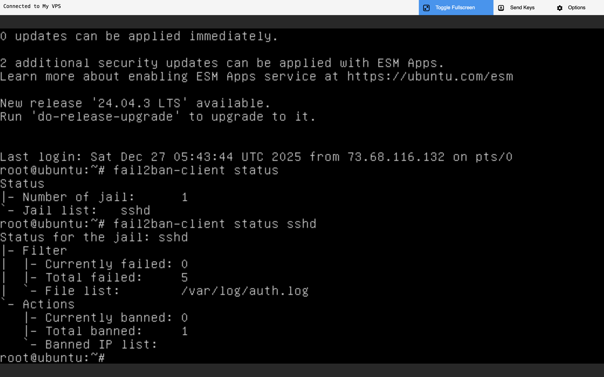

# SSH authentication monitoring with Fail2Ban

In this Ubuntu 22.04 lab, I investigated repeated SSH login failures and checked whether Fail2Ban blocked the test source. The SSH jail recorded **five failures and one ban**. After a manual unban, I verified access from the test host and checked the jail counters again.

## Environment and detection rule

The monitored host was an IONOS VPS running OpenSSH. A separate Kali Linux host generated the test traffic. The [SSH jail configuration](config/jail.local) enables the jail and sets a threshold of five failures within ten minutes, with a ten-minute ban duration.

## What I verified

| Question | Evidence | Finding |
| --- | --- | --- |
| Was the monitoring service running? | [Service status](evidence/screenshots/02_fail2ban_enabled_running.png) | The service was enabled and active. |
| What triggered the investigation? | [Authentication log excerpt](evidence/logs/failed_password_sample.txt) | The sample shows two failed password entries for the root account from the same masked source. |
| Did Fail2Ban act? | [Ban log excerpt](evidence/logs/fail2ban_ban_samples.txt) | The SSH jail issued a ban for the source shown in the sample. |
| What happened after the manual unban? | [Recovery session](evidence/screenshots/Fail2Ban_Access_Restored_After_Unban.png) | I regained SSH access. The jail reported five total failures, one total ban, and zero currently banned addresses. |

### Recovery check on the monitored host



The manual unban let me test recovery immediately. The counters are cumulative. The two saved text excerpts illustrate detection and enforcement, while the [authentication screenshot](evidence/screenshots/02_AuthLog_SSH_Failed_Attempts.png) also shows timestamps and repeated-message summaries.

## Checks used during the investigation

```bash
grep 'Failed password' /var/log/auth.log
fail2ban-client status sshd
grep 'NOTICE.*Ban ' /var/log/fail2ban.log
```

## Lessons and follow-up

I could verify three distinct events: OpenSSH recorded authentication failures, Fail2Ban issued a ban, and access worked again after I removed the ban. For a real alert, I would correlate the source and timestamps with accepted logins before assessing whether an account was compromised.

Possible follow-up work includes disabling direct root SSH login, enforcing key-based authentication, reviewing firewall rules and forwarding authentication events to Wazuh.

[All six original screenshots](evidence/screenshots/) · [Analyst notes](notes/analyst-notes.md) · [Lab timeline](notes/timeline.md)
